# Mnema Talk

**A small, self-hosted home for one community: text channels, drop-in Talks
and screen sharing up to 4K at 60 FPS, in one Go binary.**

[](https://github.com/msch128/mnema-talk/actions/workflows/ci.yml)
[](https://github.com/msch128/mnema-talk/releases/latest)
[](LICENSE)
[](go.mod)

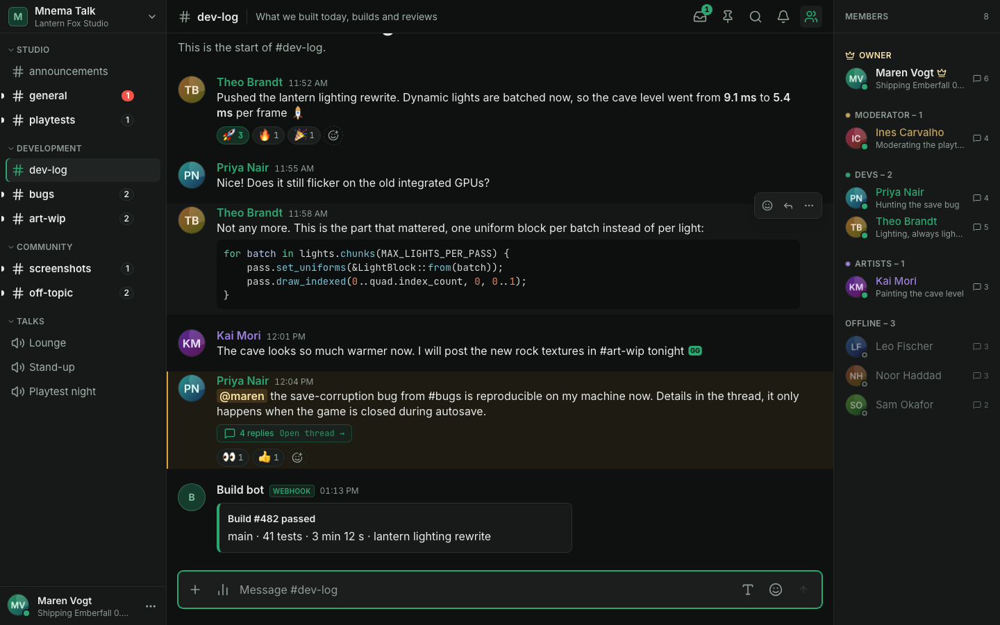

Mnema Talk is a self-hosted alternative to Discord for a group that wants its
own place: friends, a club, a guild or a small team. It has one community
instead of many servers, private direct messages without a back door for moderators, no ringing and its own quiet, dark
design. It keeps the parts that make a community server useful: roles, private
channels, webhooks, bots and a call you can join with one click. Invite-only,
no accounts on someone else's platform.

**[Download the desktop app (Beta, unsigned)](https://github.com/msch128/mnema-talk-desktop/releases/latest)**: Windows installer and portable ZIP, a macOS disk image and Linux AppImages and .deb packages live in their own repository; releases here carry the Docker image and the signed web bundle. Prefer the browser? Nothing to install, see [Quick start](#quick-start) to host it.

[Why Mnema](#why-mnema) · [Features](#features) · [Quick start](#quick-start) ·
[Desktop (Beta)](#desktop-beta) · [Documentation](#documentation) ·
[Security](#security-and-privacy) · [Contributing](#contributing)

## Why Mnema

- **Yours, and small to run.** One Go binary with the web app built in, plus
  PostgreSQL and S3-compatible storage (SeaweedFS by default): three
  containers on a NAS, a Raspberry Pi or a small VPS (linux/amd64 and arm64).
  Low idle memory, no transcoding.
- **Media is end-to-end encrypted.** Microphone, camera and screen are sealed
  in the browser with MLS-derived keys, so an honest server that relays them
  cannot read them. Text messages are *not* end-to-end encrypted and stay
  readable by the server, by design.
- **Screen sharing built for quality.** Share the source up to 4K at 60 FPS
  (hardware encoding in the browser, so the result depends on your machine and
  network). Each viewer picks a quality layer or leaves it on Auto, and
  watching is opt-in. Our tests use synthetic capture, not real 4K/60 hardware.
- **Privacy you can check.** No telemetry (the optional release check is the
  only call home and can be turned off), no third-party STUN unless you
  configure it, nothing deleted or recorded unless you turn it on, and members
  can export and delete their own data themselves.
- **Honest about its limits.** The browser app is the primary client; the
  desktop client is Beta and unsigned; 1.0 had an internal security review,
  not an external audit. The status of every area is in
  [doc/product-status.md](doc/product-status.md).

## Features

### Talk (voice, camera, screen)

- **Hangout spots.** Click a Talk and you are in. A reload within 30 seconds
  puts you back into the call. To only read (or write in) a Talk's chat, use
  the speech-bubble button on the Talk's row: the Talk opens as a preview with
  its chat, nothing is joined and no microphone is requested until you press
  **Join** in the Talk's header. Reading needs *View channels*, writing
  *Send messages*; *Connect* is not required.
- **Create-a-Talk lobbies, Stages and live reactions.** Joining a lobby opens a
  temporary Talk named after the lobby ("Lobby 1", "Lobby 2", ...) that you lead; it disappears when it
  is empty. *Start a Talk* in a direct message opens one and invites the
  conversation. A Talk can be a **Stage**: only members with talk power speak,
  others raise a hand and a member with *Manage stage* accepts it. Members in a
  Talk can send emoji reactions that float over their tile. Details in
  [doc/talks.md](doc/talks.md).
- **Screen sharing up to source quality**, up to 4K at 60 FPS with hardware
  encoding in the browser. A share is sent as the source plus smaller **layers**;
  every viewer picks a layer or leaves it on **Auto**, which follows the
  receiver reports, so each viewer is served separately. Watching is opt-in
  and everyone sees who watches.
- **A Talk view built for long sessions.** Participant grid, a stage for the
  share or camera you focus, full screen, picture-in-picture while you read
  another channel, per-person and per-stream volume, push-to-talk, noise
  suppression and the Talk's own chat as a resizable panel. If your microphone
  is on but its raw signal stays completely silent, you get a notice once per
  call; you can dismiss it, or turn it off in the audio settings.
- **No transcoding.** A Pion-based forwarding unit (SFU) copies RTP packets;
  see [doc/architecture.md](doc/architecture.md).

| A Talk where one member shares a code editor, with the viewing quality menu | The connection details with the safety code and the members holding the keys |
|---|---|
| 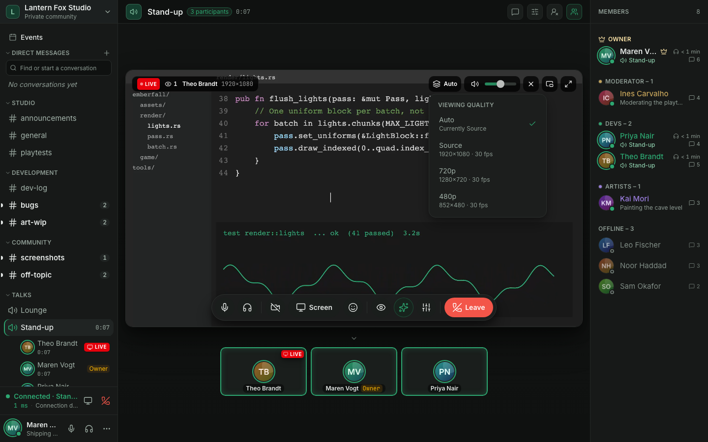 | 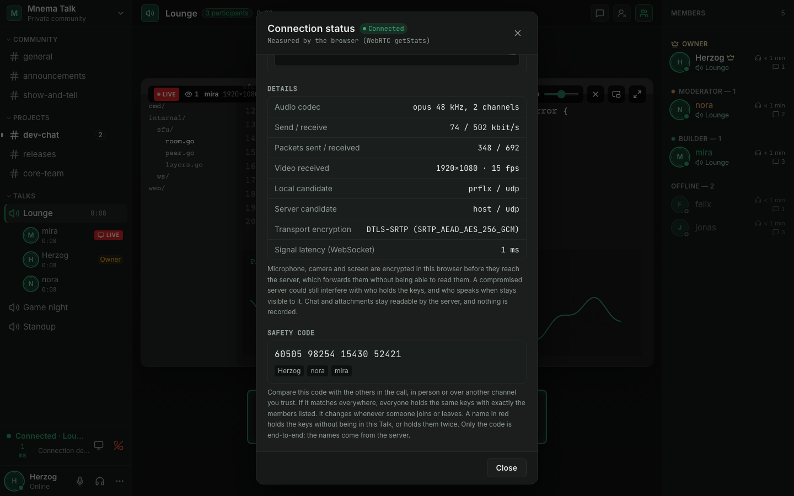 |

### Chat

- Discord-style Markdown (headings, lists, quotes, links, code blocks with syntax highlighting), replies that jump to the original (also thousands of messages
  back), threads, reactions, emoji, @mentions, file and image attachments,
  link cards, search, typing notices, unread and mention markers,
  per-channel notification settings and presence with a status line.
- **A composer that grows** with multi-line text. Paste (Ctrl/Cmd+V), drag and
  drop or pick up to 10 files per message: they wait in a tray above the composer
  (upload progress, remove, retry) and go out only when you send. Several images
  show as a gallery; a viewer steps through them with file name, sender, time, size and
  dimensions.
- **Pinned messages** (with who pinned them and when), **polls**, **custom
  emoji** managed by the community (and `:shortcode` suggestions for standard emoji), **edit history** for moderators, **drafts**
  that survive a reload and a **jump to the first unread message**.
- **Anonymous polls and channels that forget.** An anonymous poll stores only
  that a member voted and how many votes each answer has, never the choice
  (so a vote is final). A channel can opt in to auto-delete after 1, 7, 30 or
  90 days; it is shown on the channel, audited, and never touches pinned
  messages or direct messages ([doc/moderation.md](doc/moderation.md#auto-delete)).
- **Speaking addresses.** Channels, Talks, forum posts and conversations have readable web addresses (`/c/general`, `/v/lounge`, `/c/ideas/p/new-kitchen-0f3a9c1e`, `/dm/alice`) that survive renames; old links by id keep working ([doc/upgrade.md](doc/upgrade.md#speaking-urls)).
- **Forum channels.** Structured discussions with posts as cards: coloured, ordered and moderator-only tags that authors can change afterwards, required tags and guidelines per forum, search, tag filter and sorting, pinned and solved posts, locks, unread markers with a jump to the first unread reply, and a first message with formatting and files ([doc/forums.md](doc/forums.md)).
- **Community events.** Scheduled events with a description, a cover image, a
  location (a Talk or free text), RSVPs and a reminder 15 minutes before the
  start. Creating them needs the *Manage events* permission, which the seeded Moderator
  and Admin roles (every role with *Timeout members*) get at the upgrade ([doc/events.md](doc/events.md)).
- **Saved messages and forwarding.** Keep a private list of up to 1,000
  messages with an optional note, or forward a message into another channel or
  a direct message. A forward is a reference, so it never shows more than the
  reader may already see. A saved message carries a small bookmark (click it to
  take the message off again), and the header's bookmark button opens *Saved &
  reminders*: your saved messages, searchable and sortable by channel, next to
  your reminders and scheduled messages.
- **Status that clears itself.** Set a custom status with **Clear after** one
  hour, tonight, tomorrow morning, never or a date and time of your own. Your
  device works out the time in your time zone; the server clears the status
  when it passes.
- **Channel descriptions and slow mode presets.** A channel's description sits
  next to its name (click it to read it in full) and is edited in the channel
  settings. Slow mode has the presets Off, 10 s, 30 s, 1 min, 5 min, 30 min and
  24 h, or any value up to 24 hours in seconds, minutes or hours.
- **Reminders and scheduled messages.** *Remind me* on a message (in 20
  minutes, 1 hour, 3 hours, tomorrow morning or at a time you pick) notifies
  you in the app and by Web Push; *Send later* next to the send button sends a
  message for you at a chosen time, in channels and direct messages. Both are
  private to you, are worked out in your own time zone, and are checked again
  when they fall due: a reminder never shows a message you can no longer see,
  and a scheduled message that the channel's rules refuse at that time stays
  as a draft instead of being posted.
- **Slash commands.** `/poll`, `/me`, `/shrug`, `/tableflip`, `/unflip`,
  `/spoiler`, `/nick`, `/thread` and `/msg` (it needs *Send direct messages*)
  for members; `/timeout`, `/ban` and `/kick` need the matching permission. Bots can add their own
  ([doc/bots.md](doc/bots.md#built-in-commands-and-polls)).
- **Threads you can follow.** A thread reply notifies the thread's followers:
  the root's author, people who replied, people mentioned in a reply and
  anyone who pressed **Follow thread**.
- **Search filters** for author (`from:` and `author:bot|webhook|member`),
  channel (`in:`), mentions (`mentions:`), dates (`before:`, `after:`, and
  `during:` for a single local day), attachments (`has:file`, `filename:`),
  links, embeds, polls, edited and pinned messages, one compact filter row with
  small pickers, `"exact phrases"`, `-excluded` words and a sort order (newest,
  oldest). A filter that matches nothing is explained, not ignored.
- **Notification settings per channel, category and server.** Right-click a
  channel or a category header (or press Shift+F10) and choose
  **Notifications**: all messages, mentions only, nothing, or "use the
  category / server default", and **Mute for...** one hour, eight hours, a day
  or until you turn it back on. **Notification settings** in the server menu
  (and the account menu) set your default for the whole server, mute the
  server, and can ignore `@all` and `@here`. A channel's own setting beats its
  category's, which beats the server default; a small marker in the sidebar
  shows a muted channel or one that only tells you about mentions. Push,
  badges and mention counts follow the level that applies.
- **Installable web app with Web Push** notifications, and a layout for phones.
- **Direct messages, blocking and reports.** Private conversations of two to
  ten members that moderators cannot browse, blocking that the other member
  is never told about, and a way to report a message to the moderators (see
  [Direct messages, blocking and reports](#direct-messages-blocking-and-reports) below).
- **Rules and onboarding** that new members accept before they write.
- One community with categories, text channels and Talks. Every Talk has its
  own text chat.
- Upload size is up to the Owner: a global limit and an optional limit per
  role, within the `MAX_UPLOAD_SIZE_MB` ceiling.
- German and English, chosen per account.

| A thread under a message | Unread divider and an @mention |
|---|---|
| 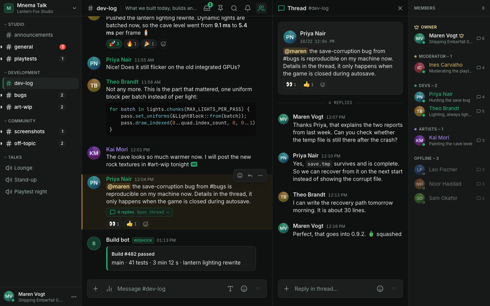 | 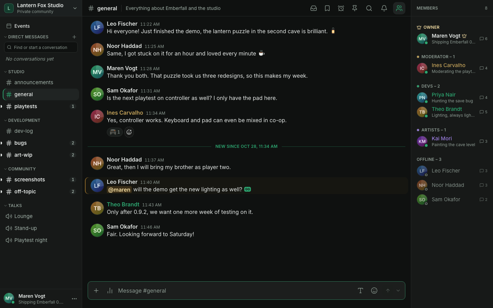 |

| Pinned rules and release schedule | A poll with votes |
|---|---|
| 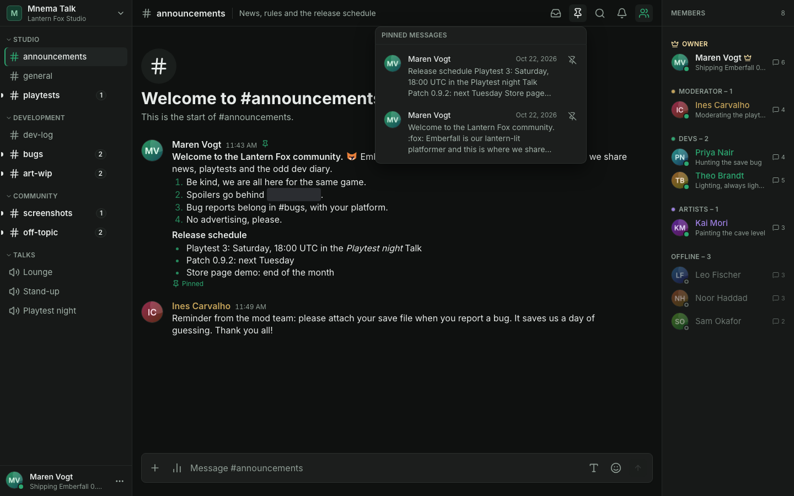 | 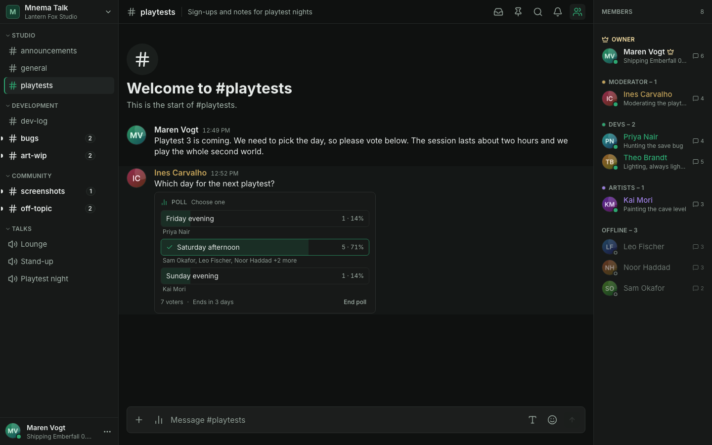 |

| The studio's own emoji | The phone layout |
|---|---|
| 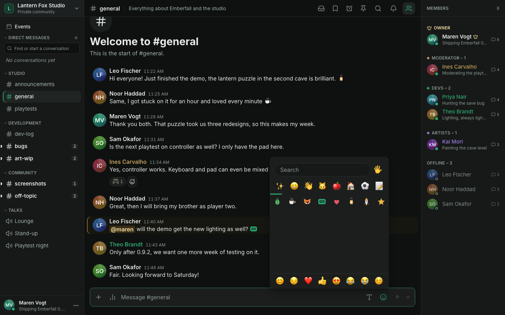 | 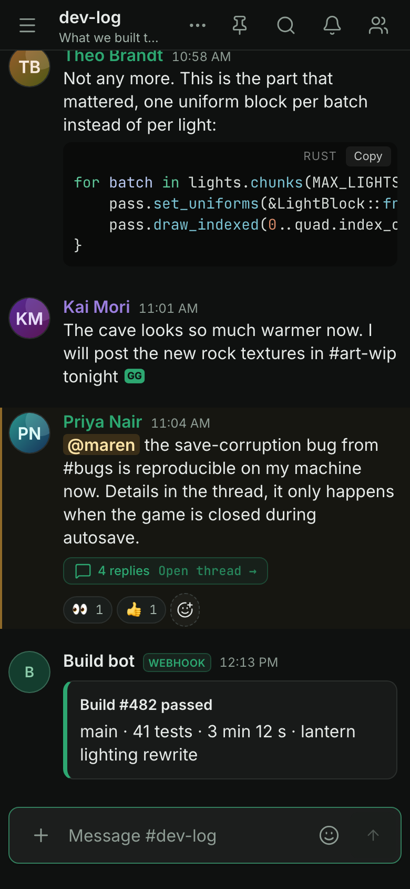 |

### Direct messages, blocking and reports

- **Start a conversation** with the **+** next to "Direct messages" at the top
  of the sidebar (on a phone: in the channel drawer), or with **Message** on a
  member's profile card or in their menu. One member makes a conversation of
  two, several make a group of up to ten people. Members added to a group
  later read its whole history. A conversation of two cannot be left (block
  the other member instead); a group can, from the conversation's info.
- **The list** shows each conversation with its face (and presence), the
  start of the latest message (with "You:" or, in a group, who wrote it),
  when, and what is new: a number for unread messages, a red @ number for
  mentions. Groups show two faces and how many people are in them. The section
  folds away with the arrow next to its name, and stays folded on all your
  devices. The box at the top (**Find or start a conversation**) finds
  conversations and members; Enter opens the first match. Ctrl/Cmd+K offers
  matching conversations too.
- **Close a conversation** with the **x** on its row or **Close conversation**
  in its menu (right-click, or the three dots on a phone). Nothing is deleted;
  the conversation comes back with the next message, or when you open it from
  the search. **Favourites**: the star puts a conversation at the top, in its
  own section (up to 25); drag to reorder, or use **Move up** and **Move down**
  in the menu (Alt+Arrow keys on a focused row). Favourites stay in the list and
  follow you to every device.
- **Mute** one conversation from the bell in its header or its menu, or all of
  them with **Mute all direct messages** under *Settings* > *Privacy* >
  *Direct messages*: no sound, no notification and no highlight, but
  unread messages still count. A conversation you muted or unmuted yourself keeps
  its own setting.
- **Who may write to you** is your choice in the same place: everyone (the
  default) or nobody. It only decides who can start a conversation; existing
  ones go on.
- **Block** a member from their profile card, their menu, a message's menu or
  the conversation info. Their messages fold into "Blocked message" (one click
  shows it), they cause no mentions or notifications for you (in any conversation,
  group included, their messages leave unread counts, mentions and last activity
  untouched), and a conversation of two with them stops working in both directions.
  They are not told. The list of blocked members, with a way to unblock, is under
  *Settings* > *Privacy*.
- **Report** a message from its menu (**Report message**) with a reason and an
  optional note. The moderators see a copy of the message and the ones around
  it in **Admin > Reports**, which needs the permission *Manage reports*; for a
  direct message this copy is the only part of it they can read. The author is
  not told.
- **The Owner and Administrators can switch direct messages off** for the community under
  **Admin > Sign-in & messages**: nothing new can then be started or written, and
  existing conversations stay readable. A 1.0.x server has none of this, and
  the web app hides it there.

### Supported browsers

Chromium-based browsers (Chrome, Edge 137+), Safari 17+ (including iOS 17+ and
the installed web app) and Firefox 129+ run the whole app. A browser that cannot
seal media does not join a Talk at all, it never sends unsealed media. CI runs
the full end-to-end suite and the phone layout in Chromium, every spec that
needs no call in WebKit, and a subset in Firefox. Calls in WebKit run in
separate macOS jobs (not a required check). Nothing is tested on real iOS
or Android hardware.
Details: [Browsers in product-status.md](doc/product-status.md#browsers).

### Encryption and privacy

- **Media is end-to-end encrypted** in the browser with keys from an MLS
  group: microphone, camera, screen video and screen audio. Keys rotate every
  30 minutes, every sealed frame is signed by its sender, and a **safety code**
  in the connection details lets members compare keys out of band.
  The old media frame format 2 is gone in 1.2: only format 3 is sealed or
  opened, so a client that old must be reloaded or updated
  ([doc/upgrade.md](doc/upgrade.md#calls-and-the-security-floor)).
- **Invite-only.** There is no public registration. Admins can change an
  invite's expiry and use limit later, or remove them. An optional vanity link
  (`/join/your-community`) leads visitors to the sign-in page; only if the
  Owner switches it on does it also create accounts
  ([doc/operations.md](doc/operations.md#vanity-invite-link)).
- **Accounts you control.** Optional e-mail (password reset needs SMTP),
  two-factor sign-in with recovery codes, and self-service export and deletion
  of your own data.

- **Hardened by default**: `HttpOnly` session cookies with revocation, CSRF
  origin check, strict CSP, upload content sniffing, rate limits and login
  lockout, an SSRF guard for outgoing webhooks, and an app port that only
  listens on loopback until you say otherwise (see the [FAQ](doc/faq.md#why-cant-i-reach-port-8080-from-another-computer)).
- **Privacy-minded**: no third-party STUN unless configured, no automatic data
  deletion unless enabled (`MEDIA_RETENTION_DAYS=0`), no telemetry (the optional release check is the only call home, and it can be
  turned off).
- Release images are signed with cosign and ship provenance and an SBOM. They are
  published on GHCR and mirrored on Docker Hub (`docker.io/msch128/mnema-talk`).

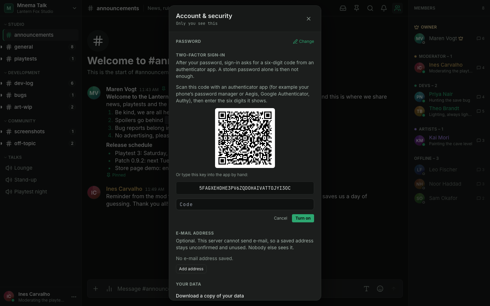

### Administration

- **An Owner and roles.** The Owner can do everything and cannot be restricted
  by anyone. Below them, custom roles hold Discord-style permissions, and
  categories and channels can allow or deny them per role or member, which
  makes **private channels and Talks**. Changes apply live, also in a call.
- **Moderation.** Timeouts (a minute to four weeks, lifted automatically, enforced in REST, the hub and the SFU), bans with reason and duration, and kicking, all bound by the role hierarchy and written to the audit log.
- **Automod and moderation history.** Automod is on by default with
  conservative rules (mention spam, links from accounts younger than 10
  minutes, raid protection) plus optional word and link lists; hits land in the
  reports queue. Members with *Manage reports* see a per-member history and
  keep private moderator notes ([doc/moderation.md](doc/moderation.md)).
- **Sessions and view-as-role.** Members see and end their own sessions
  (*Where you are signed in*), and a session unused for 7 days (adjustable)
  signs out. In the role editor, **View server as** previews what a role sees.
- **Discord import.** An admin can copy the categories, channels, Talks and roles
  of a Discord server from a template link: additive, after a preview and
  three confirmations, and it can be undone ([doc/import.md](doc/import.md)).
  A Discord role can be connected to an existing role instead of created anew
  (same-name roles are suggested; the protected Bot role is never overwritten).
- **Audit log.** An append-only record of administrative and moderation
  actions with who, what, before and after, filterable in the admin console.
  It also holds deleted message text and Talk presence history, so mention it
  in your privacy notice; `AUDIT_RETENTION_DAYS=0` keeps it forever.
- **Webhooks.** Incoming ones in Discord's execute format (so most existing
  integrations work) and outgoing ones that POST signed events to your service
  with retries and a delivery log.
- **Bots.** Bot accounts with API tokens, scoped by roles and channel overwrites like members, a REST API and a gateway modelled on Discord's (see [doc/bots.md](doc/bots.md)); only the Owner and *Manage bots* create them.
- **Admin console** for members (disable, kick, reset password, revoke
  sessions), roles, channel layout, invites, media and storage, and a System
  tab with health and a live operator view, and a Status page (version,
  updates, database, storage, backups and live activity; its checks follow the display language). The sidebar supports drag and drop
  with undo.

| Roles and permissions | Webhook settings |
|---|---|
| 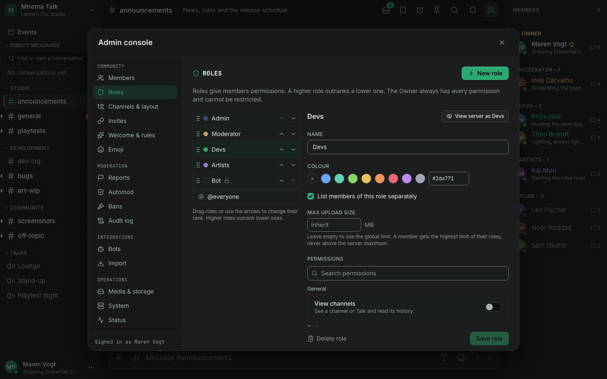 | 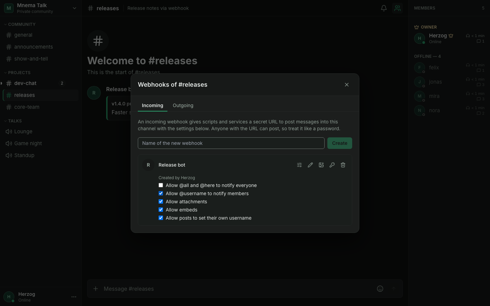 |

### Operations

- **One binary, three containers**: `app`, PostgreSQL 18 and SeaweedFS (any S3
  store works). Low idle memory; images for linux/amd64 and linux/arm64, so a
  NAS or a Raspberry Pi works.
- **Observable**: Prometheus metrics at `/api/metrics`, a live operator view in
  the System tab, and alert rules you can copy
  ([doc/operations.md](doc/operations.md#monitoring-and-alerts)).
- **Recoverable**: backup and restore scripts, plus drills in CI that prove
  them: backup to restore, release-to-release upgrade and the PostgreSQL move.
- **Measured**: `make load-test` reproduces a 100-member call with real
  decrypting browsers and lightweight viewers
  ([loadtest/README.md](loadtest/README.md)). On a 4-core Intel N100 home
  server, 1,000 concurrent chat sessions used about 0.7 CPU cores (95th
  percentile delivery 84 ms) and one screen share to 99 members about 0.6
  cores; see [doc/benchmark.md](doc/benchmark.md) for the method and limits.
- A TURN relay built into the server for members behind firewalls that block
  UDP (on by default while no external TURN is configured), an optional
  `coturn` profile and a self-update sidecar (`autoupdate` profile, off by
  default).

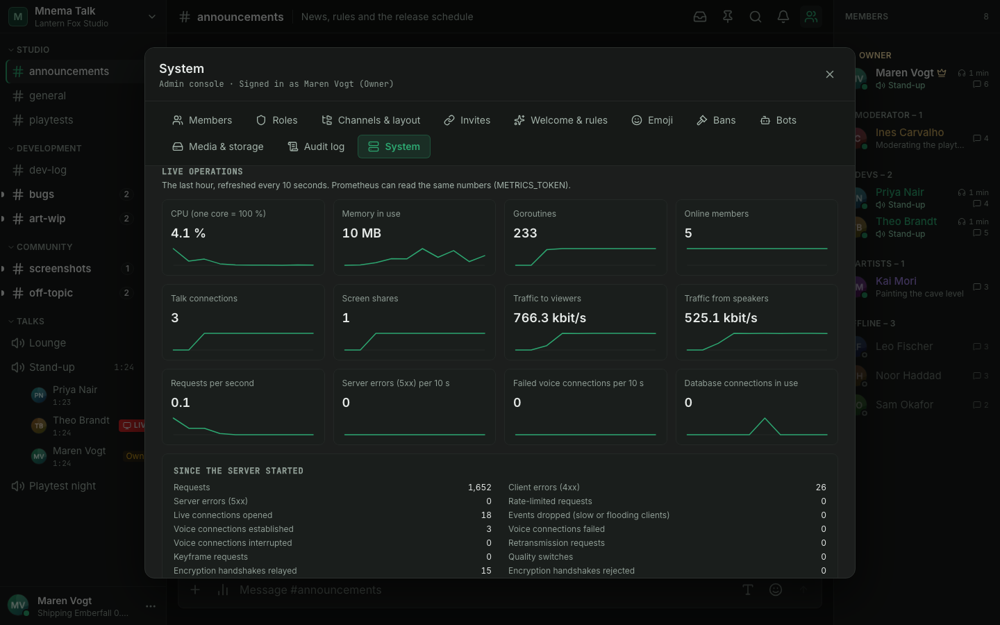

## Quick start

New to self-hosting? Follow the **[quick start](doc/quick-start.md)**: one path
for a NAS, a home server or a VPS, with every term explained and a way to check
each step. In short, you need:

- a machine that runs Docker with Compose (a Synology or Unraid NAS, a Raspberry
  Pi 4/5, any Linux box or a small VPS); what size you need depends on the
  Talks you run, see [Hardware by size](doc/deployment.md#hardware-by-size),
- a domain name with HTTPS, set up through a *reverse proxy* (a small web server
  in front of the app that holds the certificate; [how](doc/reverse-proxy.md)),
- three open ports: TCP 443 for the site, and UDP 50000-50050 plus port 3479
  for voice (voice and video do not travel through the proxy; the quick start
  explains [why](doc/quick-start.md#how-it-fits-together)).

No clone and no build are needed. The setup assistant asks a few questions and
writes the configuration, including every secret:

```sh
mkdir mnema-talk && cd mnema-talk
docker run --rm -it --user "$(id -u):$(id -g)" -v "$PWD:/out" ghcr.io/msch128/mnema-talk setup
docker compose up -d --wait
```

Then open your address and sign in as the Owner (default user name `admin`,
password printed by the assistant; `ADMIN_INITIAL_PASSWORD` only creates the
account on the first start, so remove it from `.env` afterwards) and create
invite codes for your members. Admin console > Status checks the setup and has a
"Test my connection" button that tells you whether voice reaches your server from
outside.

Just want to look around first? The quick start has a
[five-minute try-out on one computer](doc/quick-start.md#try-it-on-one-computer-first).
Is it a fit for your line? Behind CGNAT or DS-Lite you cannot host at home; see
[Can I host at home?](doc/quick-start.md#can-i-host-at-home).

Where to go next:

| If you want to | Read |
|---|---|
| Understand a word (STUN, TURN, NAT, WebSocket ...) | [Glossary](doc/glossary.md#voice-and-network-terms) |
| Set up HTTPS (Caddy, Synology, Nginx Proxy Manager, nginx) | [doc/reverse-proxy.md](doc/reverse-proxy.md) |
| Fix "No media connection" or "Connection lost" | [doc/troubleshooting-voice.md](doc/troubleshooting-voice.md) |
| Ask about domains, dynamic DNS, Cloudflare, tunnels, a Pi | [doc/faq.md](doc/faq.md) |
| Open the right ports (router table) | [doc/ports.md](doc/ports.md) |
| Install by hand instead of the assistant | [Fresh install](doc/deployment.md#fresh-install) |
| Update or back up | [doc/updating.md](doc/updating.md) |

The same image is also on Docker Hub as `docker.io/msch128/mnema-talk`; GHCR
stays the primary reference ([verify the signature](doc/operations.md#verifying-a-release-image)).
Building from source is for development; see [Development](#development).

Two defaults to know about:

- **`PUBLISH_ADDR`** is `127.0.0.1`: the app port is reachable only from the
  machine itself, which is what a reverse proxy on the same machine needs. Set it
  to a LAN address when the proxy runs elsewhere ([FAQ](doc/faq.md#why-cant-i-reach-port-8080-from-another-computer)).
- **`TRUSTED_PROXY_CIDRS`** is empty, which trusts loopback only. A reverse
  proxy on another machine or in a container must be listed here by address,
  otherwise all members share the proxy's IP for rate limits and login lockout.
  The Status tab names the value to use. Production refuses a range wider than a
  small network; see [the upgrade note](doc/upgrade.md#broad-trusted-proxies).

### Upgrades and backups

Take a backup before every update (`scripts/backup.sh`; restore with
`scripts/restore.sh`, which can verify a backup in a disposable container
first). Migrations run at startup and are forward-only. The procedure is on one
page, [doc/updating.md](doc/updating.md); per-version notes and the rollback are
in [doc/upgrade.md](doc/upgrade.md). Admins see new releases in the System tab; an
optional update button needs the `autoupdate` profile.

## Security and privacy

In a few honest sentences:

- **Media** (microphone, camera, screen video and screen audio) is encrypted in
  the browser with MLS-derived keys, so an honest server, and anyone who only
  sees the forwarded packets, cannot read it. The server still serves the web
  app's code and relays the key exchange, so a malicious or compromised server
  could subvert it; members who compare the safety code notice most such
  attacks. Who speaks when, and who is in which Talk, stays visible to the
  server.
- **Text messages and attachments** are readable by the server, as on
  Discord. Nothing is recorded and nothing is deleted automatically unless you
  turn retention on.
- **The desktop client removes server-served JavaScript**: it runs a signed web
  bundle that it verifies itself, so the server supplies data, never code.
- Transport is HTTPS and DTLS-SRTP. 1.0 has had an internal six-lane security
  review, not an external audit ([SECURITY.md](SECURITY.md#10-internal-security-review)).

The full model, its limits and how to report a vulnerability privately are in
[SECURITY.md](SECURITY.md); the product's test scope is in
[doc/product-status.md](doc/product-status.md).

## Desktop (Beta)

The [desktop client](https://github.com/msch128/mnema-talk-desktop) for Windows,
macOS (Apple silicon) and Linux (**Beta**, unsigned; Windows installer and
portable ZIP, macOS disk image, Linux AppImage and .deb) wraps the same web app. Instead of loading code from
your server it runs a **signed bundle** that it verifies on every start, with
rollback protection and a security floor, and keeps the session in the OS
keychain. On Windows it adds a gaming sidepeek and an `Alt+M` overlay for your Talk. The
browser app remains the primary, fully supported client. The installer is
not code-signed (no paid certificate), so Windows SmartScreen warns on first
start (macOS shows a Gatekeeper warning); the steps are in
[doc/desktop-app.md](doc/desktop-app.md#installing-the-unsigned-beta). Details
and the threat model: [doc/desktop-trusted-client.md](doc/desktop-trusted-client.md).

## Documentation

| Topic | Where |
|---|---|
| **Read first when updating:** what 1.0 promises and what to do before updating; the 1.1 and 1.2 changes are in the upgrade notes | [doc/release-notes-1.0.md](doc/release-notes-1.0.md), [doc/upgrade.md](doc/upgrade.md) |
| Components, data flow, capacity | [doc/architecture.md](doc/architecture.md) |
| Configuration, reverse proxy, TURN, backups, metrics and alerts, troubleshooting | [doc/operations.md](doc/operations.md) |
| Quick start (setup assistant), platform notes (Synology, Unraid, VPS), HTTPS and reverse proxy | [doc/quick-start.md](doc/quick-start.md), [doc/platform-notes.md](doc/platform-notes.md), [doc/reverse-proxy.md](doc/reverse-proxy.md) |
| Voice and connection problems, FAQ | [doc/troubleshooting-voice.md](doc/troubleshooting-voice.md), [doc/faq.md](doc/faq.md) |
| Network ports and outbound connections | [doc/ports.md](doc/ports.md) |
| Updating, image tags | [doc/updating.md](doc/updating.md) |
| Manual install, platforms | [doc/deployment.md](doc/deployment.md) |
| Upgrade notes per version, rollback | [doc/upgrade.md](doc/upgrade.md) |
| Roles, permissions and private channels | [doc/roles-and-permissions.md](doc/roles-and-permissions.md) |
| Product vocabulary (en/de) used in the UI and docs, and voice and network terms | [doc/glossary.md](doc/glossary.md) |
| Moderation and the audit log | [doc/moderation.md](doc/moderation.md) |
| Webhooks (incoming and outgoing) | [doc/webhooks.md](doc/webhooks.md) |
| Bots, the bot API and gateway | [doc/bots.md](doc/bots.md) |
| What is public API and how it may change (1.0 stability promise) | [doc/api-stability.md](doc/api-stability.md) |
| Where media keys live in the browser | [SECURITY.md](SECURITY.md#security-model-summary) |
| Web client code (TypeScript) | [doc/typescript.md](doc/typescript.md) |
| Trusted desktop client, gaming overlay | [doc/desktop-trusted-client.md](doc/desktop-trusted-client.md), [doc/desktop-app.md](doc/desktop-app.md) |
| Load test, benchmark | [loadtest/README.md](loadtest/README.md), [doc/benchmark.md](doc/benchmark.md) |
| Product status and acceptance | [doc/product-status.md](doc/product-status.md) |
| Building, testing, CI, releases | [doc/development.md](doc/development.md) |
| Contributing, conduct and getting help | [CONTRIBUTING.md](CONTRIBUTING.md), [CODE_OF_CONDUCT.md](CODE_OF_CONDUCT.md), [SUPPORT.md](SUPPORT.md) |
| API reference | `API_DOCS_ENABLED=true` serves it at `/api/docs` to signed-in members |

## Development

Requirements: Go (see `go.mod`), Node and npm, Docker, GNU make. `make help`
lists every target.

```sh
make install-hooks      # pre-commit: gitleaks + gofmt
make dev                # postgres + seaweedfs in Docker, server on :8080 (reads .env)
cd web && npm run dev   # Vite on :3000, proxies /api to :8080
make check              # everything CI runs
make e2e                # Playwright against the real binary
```

Stack: Go, chi, pgx, Pion WebRTC; Vue 3, Pinia, Vite and Tailwind CSS 4 in
strict TypeScript; PostgreSQL 18; S3-compatible storage. More in
[doc/development.md](doc/development.md).

## Contributing

Pull requests are welcome. [CONTRIBUTING.md](CONTRIBUTING.md) has the setup
(`make dev`), the quality gates, the commit conventions and how pull requests
go into release branches; [AGENTS.md](AGENTS.md) holds the full rules and
applies to people and AI agents alike. The repository is public: never commit
secrets, databases or uploads. Please follow the
[Code of Conduct](CODE_OF_CONDUCT.md). Questions: [SUPPORT.md](SUPPORT.md).
Report vulnerabilities privately as described in [SECURITY.md](SECURITY.md).

## License

Copyright (C) 2026 Marius Schröder ([msch128](https://github.com/msch128)).

Mnema Talk is licensed under the
[GNU Affero General Public License v3.0](LICENSE) (AGPL-3.0-only). You may
use, change and share it, also commercially, as long as you publish the
complete source code of your version under the same license. That includes
running a changed version as a network service: its users must be able to get
the source (the legal dialog in the app links to it; point `SOURCE_URL` in
`web/src/lib/thirdParty.ts` at your own repository).

**Commercial license:** to use Mnema Talk, or parts of it, without the AGPL
obligations (for example in a closed-source product or service), get a
separate commercial license from the copyright holder. Contact
[msch128 on GitHub](https://github.com/msch128).

Contributions are accepted under the AGPL-3.0, and their authors agree that
Marius Schröder may also distribute them under a commercial license.
